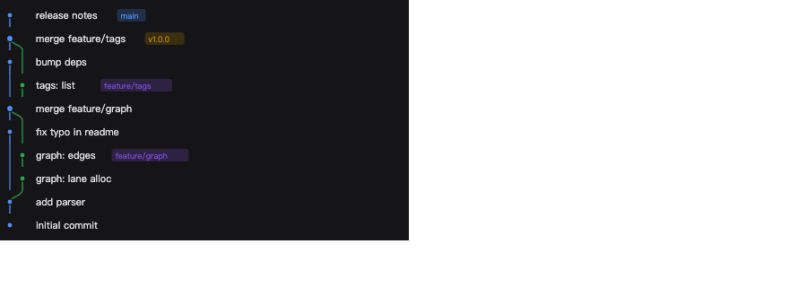

# dsh-git-explorer

一个面向 DeepSeek Harness（DSH）的 Git 工作台插件。它把提交图、仓库状态、提交历史、分支、标签、储藏、比较、逐行追溯和 diff 放进 DSH 的界面里，而不是另起一个独立窗口。

- **右侧边栏**：一个 Git 面板，与文件、工具等面板并列。
- **会话顶部标签栏**：与「对话 / 轨迹」并列的 Git 标签页，显示完整工作台。
- **会话标题栏按钮**：一个 Git 分支图标，点击直接在右侧边栏打开 Git 面板。
- **可拖动的分栏**：改动列表/提交框、提交详情、比较、行历史等区域之间都有一根分隔条，拖动即可调整两侧宽度或高度，双击分隔条恢复默认。

## 功能

### 改动（Changes）

- 已暂存 / 未暂存 / 未跟踪 / 冲突分组
- 单文件或全部暂存、取消暂存、丢弃改动
- **按块（hunk）暂存**：详情面板里逐块勾选暂存 / 取消暂存 / 丢弃，单块也能一键处理
- 点击文件查看 unified diff，带旧/新行号、增删统计
- **宽屏下可切换并排（side-by-side）对比**：左侧旧文件、右侧新文件，逐行对齐；窄侧边栏仍用竖向统一视图
- 提交框支持 `⌘/Ctrl + Enter` 提交、`--amend`、提交前暂存全部改动、`--signoff`、`--no-verify`
- 顶部显示当前分支、领先/落后远端提交数、改动文件数，以及 **拉取 / 推送** 按钮
- 拉取支持 `--rebase`、`--autostash`；推送支持 `-u`、`--force-with-lease`、`--follow-tags`
- 改动列表与底部提交框之间可上下拖动分隔条调整高度

### 提交图（Graph）



- 车道（lane）自动分配：合并提交分叉、跨分支的边缘连线、refs 徽标
- 顶部可切换「所有引用 / 仅当前分支」，显示车道数
- 支持分页加载更多
- 点击任意提交打开右侧详情；详情里可拣选、还原、合并、打标签

### 历史（History）

- 提交列表：短哈希、作者、相对时间、refs（本地分支 / 远端分支 / tag）
- 按提交信息或作者搜索，跨所有 refs
- 分页加载更多
- 提交详情：作者、时间、完整 message、父提交跳转、refs、远端打开、复制哈希
- 单文件 history / blame 快捷入口；文件历史可作为过滤器回填到历史列表
- 超大提交只加载文件清单，选中文件后再按需拉取该文件的 diff

### 分支（Branches）

- 本地分支 / 远端分支分组，当前分支高亮
- 检出本地分支
- 远端分支自动创建同名本地跟踪分支并检出
- 新建分支（可指定起点）
- 删除本地分支、抓取远端
- 把某个分支合并到当前分支，或直接跳去和当前分支做比较

### 标签（Tags）

- 列出轻量标签与附注标签，显示目标提交、标题、时间
- 新建标签（可指定目标提交；填了说明就是附注标签）
- 删除标签，可选同时删除远端标签
- 检出标签（会提示进入游离 HEAD）

### 储藏（Stashes）

- 列出储藏、相对时间、哈希
- 保存储藏（可选包含未跟踪文件）
- 恢复 / 删除

### 比较（Compare）

- 任意两个 revision 之间比较
- 左侧提交清单，右侧文件清单与按需加载的 diff
- 左右两侧宽度可拖动调整
- 文件 diff 支持统一视图 / 并排视图切换

### 追溯（Blame）

- 任意文件逐行归属：行号、提交短哈希、作者、日期、代码
- 按时间做热力着色
- 可选起始行 / 结束行
- 点击哈希直接打开该提交详情
- 文件路径输入带仓库已跟踪文件补全
- **文件注解摘要**：作者占比、最近改动时间、按提交年龄分布的热力条
- **行历史**：选定行范围后用 `git log -L` 追这一段的改动历史，左侧列表右侧 diff（可拖动调整宽度，diff 支持并排对比）
- 逐行结果超过 3000 行会标注已截断

## 安装

**桌面版（DeepSeek Harness.app）**：侧边栏 **插件** → **Add plugin** → **Install a third-party plugin** → 输入 `dsh-git-explorer` → **Install** → **Enable now**，然后重启应用。

**命令行**（`web`、`headless` 等自建 profile）：

```bash
dsh plugin --profile <你的 profile> add dsh-git-explorer
```

把 `<你的 profile>` 换成实际的 profile 名，然后**完全重启 DSH**。

装完不需要编辑任何配置文件，右侧边栏的 Git 面板、会话顶部的 Git 标签页和标题栏按钮都会自动出现。安装后必须重启一次 DSH，只刷新浏览器不够。

**升级**：

```bash
dsh plugin --profile <你的 profile> add dsh-git-explorer@latest
```

**卸载**：

```bash
dsh plugin --profile <你的 profile> remove dsh-git-explorer
```

三点说明：

- 包名是 `dsh-git-explorer`。原来的 `dsh-git-panel` 已被 npm 上的另一个项目占用，用旧名字会装错包。
- npm 若指向国内镜像（如 `registry.npmmirror.com`），新版本发布后可能几小时内还查不到，报 404 时等镜像同步或改用官方源。
- 不要用外部 `dsh` 命令操作 `desktop` profile：它被桌面应用独占管理，会报 `profile "desktop" is managed exclusively by the Electron application`。桌面版只走插件页。

## 验证

```bash
npm test           # 四套全跑
npm run smoke      # host：仓库发现、status、log、diff、blame、tags、graph、hunk
npm run test:graph # 车道分配算法（合并、分叉、游离根、窗口边界）
npm run test:render# 用最小 React/DOM 桩把真实组件树挂到真实仓库上，驱动各个 tab
npm run test:route # 把 apply() 挂到真实 http.Server，用真实 fetch 打每个接口
```

- `scripts/smoke.mjs` 建临时仓库，验证 host 的读接口和 hunk 的 `git apply` 往返（含 `--follow` 跨改名、单块暂存/取消暂存）。
- `scripts/graph-test.mjs` 从 `client.js` 里抽出 `assignLanes` 单独跑，覆盖线性历史、合并、游离根、窗口外父提交和宽度上界。
- `scripts/render-test.mjs` 提供最小的 React hook 实现、假 DOM，并把 `fetch` 直接接到 host 的 `dispatch`，所以界面是真的在渲染、真的在读仓库；它逐一点开提交图、标签、追溯、hunk 面板和推送对话框，还会真的暂存一个块再断言索引变化（32 项），并校验可拖动分栏的分隔条、以及宽屏提交详情的并排对比开关已渲染。
- `scripts/route-test.mjs` 把 `apply()` 注册的 handler 挂到真实 `http.Server` 上，用真实 `fetch` 覆盖 18 个只读方法、hunk 往返、标签增删、储藏、路径逃逸、未知方法、工作区越界和同源守卫（38 项）。

另外在真实 DSH 实例里做过一次端到端验证：用临时 profile 加载本插件启动 `dsh --profile gitcheck`，确认 `client.js` 进入 `__DSH_BOOT__` manifest 并由 `/plugins/??...` 正确分发，`overview`/`status`/`log`/`branches`/`tags`/`graph`/`hunks` 全部返回 200，无 token 时被本插件的同源校验拦成 403。测试实例与临时 profile 已清理。

## 已知限制

- 右侧边栏宽度较窄时，diff 会自动改为上下布局。
- 分栏位置保存在组件内存里（切换 tab、开关详情面板期间保留），刷新页面后回到默认比例，不会持久化到磁盘。
- 改动/历史列表未做虚拟滚动；超大提交的文件清单最多渲染前 500 行，剩余数量以提示文字标出。
- 提交图一次最多取 1200 个提交（默认 300，滚动到底加载下一页），不做窗口化虚拟滚动。
- 没有编辑器内的 inline blame / CodeLens / 文件注解叠加层：DSH 客户端没有暴露编辑器装饰或 CodeLens 槽位（可注册的槽只有会话、侧边栏、设置、文档预览这几类），所以用「文件注解摘要 + 行历史」作为等价物。
- 不支持图形化 merge conflict 编辑、pull request、GitHub/GitLab API 集成。
- 交互式 rebase、AI 生成提交信息 / 解释改动 / review 仍未实现。
- 写操作只覆盖白名单里的动作，不支持任意 `git` 命令。

## 接口一览

`POST /dsh-git/api/<method>`，所有请求都要带上会话工作区（`sessionId` 或 `cwd`），仓库根会在 host 重新校验。

| 类别 | method |
| --- | --- |
| 只读 | `discover` `overview` `status` `log` `commit` `diff` `blame` `branches` `tags` `stashes` `remotes` `files` `fileHistory` `lineHistory` `graph` `hunks` `search` `compare` |
| 写操作 | `action`，`action` 取值：`stage` `unstage` `discard` `stageHunks` `unstageHunks` `discardHunks` `commit` `checkout` `createBranch` `deleteBranch` `fetch` `pull` `push` `merge` `cherryPick` `revert` `abortOperation` `stashSave` `stashPop` `stashDrop` `createTag` `deleteTag` |
